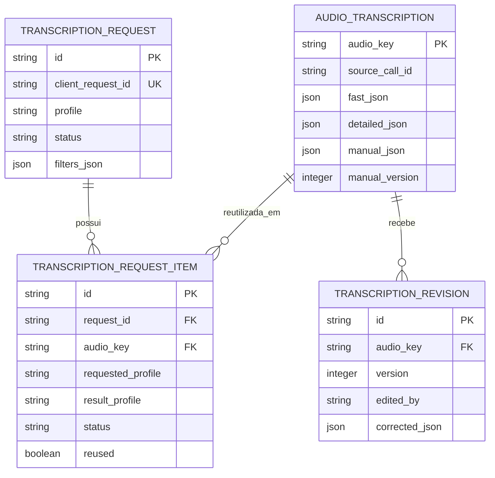

# API de transcrição para o Atlas

## Modelo de dados



`transcription_request` controla a solicitação e sua espera. A mesma
`audio_transcription` pode aparecer em várias solicitações por meio de
`transcription_request_item`.

Uma solicitação rápida reutiliza uma transcrição detalhada existente. Uma solicitação
detalhada não reutiliza apenas a rápida. A versão efetiva segue a prioridade: edição
manual, transcrição detalhada e transcrição rápida.

## Criar solicitação

`POST /api/v1/transcription-requests`

```json
{
  "perfil": "rapido",
  "duracao_minima_segundos": 20,
  "duracao_maxima_segundos": 300,
  "tabulacoes": ["PROMESSA", "SEM_ACORDO"],
  "quantidade_por_operador": 10,
  "data_inicial": "2026-08-01",
  "data_final": "2026-08-03",
  "carteiras": ["ETA"],
  "limite_total": 100,
  "client_request_id": "atlas-20260803-12345"
}
```

`client_request_id` torna a chamada idempotente. A resposta HTTP 202 contém o
`request_id`, progresso, tempo estimado do lote, tempo da fila e previsão de conclusão.

## Endpoints

- `GET /api/v1/transcription-requests/{request_id}`: progresso do lote.
- `GET /api/v1/transcription-requests/{request_id}/items`: itens paginados.
- `GET /api/v1/transcriptions/{audio_key}`: versões rápida, detalhada, manual e efetiva.
- `GET /api/v1/transcriptions/{audio_key}/revisions`: auditoria das edições humanas.
- `POST /api/v1/transcription-requests/{request_id}/items/{audio_key}/reprocess-detailed`:
  reprocessamento detalhado sem apagar a versão rápida.

## Edição humana

`PATCH /api/v1/transcriptions/{audio_key}/manual`

```json
{
  "edited_by": "usuario.atlas",
  "reason": "Correção após escuta do áudio",
  "transcription": {
    "full_text": "operador: Prazer, eu sou o Caio...",
    "timeline": []
  }
}
```

Cada salvamento incrementa `manual_version` e cria uma revisão imutável.

## Tabela de ligações do Atlas

Durante o desenvolvimento, `LocalAudioCatalog` seleciona arquivos da pasta `audios`.
Ele aplica duração e limite, mas sinaliza que período, tabulação, carteira e quantidade
por operador ainda dependem do adaptador definitivo.

Quando a tabela estiver definida, somente o catálogo será substituído. A API, o worker
e as tabelas de transcrição permanecem iguais.

## Executar

No VS Code, selecione `1. INICIAR API PARA O ATLAS`, ou execute:

```powershell
.\venv\Scripts\python.exe api_main.py
```

- Swagger: `http://127.0.0.1:8000/docs`
- Saúde: `http://127.0.0.1:8000/health`

Nesta máquina, mantenha `API_WORKERS=1`.
